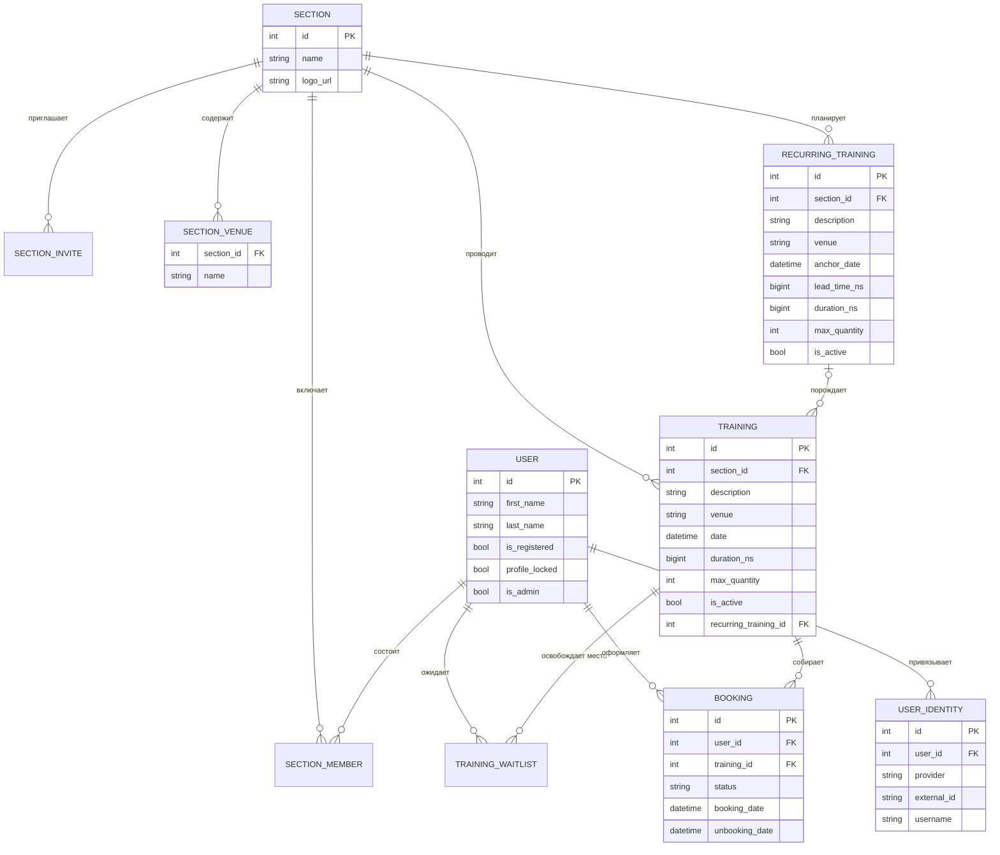

# ProdApp | Запись на тренировки

ProdApp помогает участникам спортивного клуба выбрать тренировку и занять место в группе. В расписании видны время начала, длительность занятия и количество доступных мест. В разделе «Мои записи» участник может проверить, на какие занятия он записан, и отменить запись, чтобы место досталось другому.

Организатор публикует разовые и еженедельные тренировки, задаёт размер группы, подтверждает регистрацию участников и отмечает посещаемость. По этим данным клуб может отслеживать неявки и поздние отмены.

## Веб-сайт и мини-приложения

Проект лабораторных работ 5–7 по дисциплине «Frontend» включает редизайн Mini App и веб-версию для компьютера и телефона. Один React-клиент работает в Telegram, VK и браузере с общим Go API. В мини-приложениях вход выполняется через платформу, на сайте используется кнопка «Войти через Telegram». В профиле можно связать Telegram и VK с одним аккаунтом по коду.

| Роль | Возможности |
| --- | --- |
| Участник | Вступление по приглашению, расписание своих секций, запись на тренировку, отмена записи, лист ожидания и личная посещаемость. |
| Администратор секции | Приглашения и ручное добавление участников, управление тренировками, сериями, записями и залами. В карточке занятия можно добавить участника, перенести запись или отметить «Был» / «Не был». |
| Системный администратор | Управление секциями, пользователями и ролями. Пункты «Секции», «Пользователи» и «Администраторы» постоянно доступны в блоке «Управление системой» внизу левой панели. На телефоне блок находится в меню «Ещё». |

[Согласованный макет сайта и Mini App](design/prodapp-preview.html)

[Макет карточки тренировки для участника и админа](design/booking-roster.html)

Расписание открывается календарём. В режиме «Список на день» видны занятия выбранного дня. Стрелки переключают месяцы или недели в зависимости от режима. В карточке сначала виден состав, а внизу – шкала заполненности и одна кнопка действия, соответствующая состоянию записи.

Для заполненной тренировки доступен лист ожидания. При освобождении места бот уведомляет ожидающих с привязанным Telegram. Место занимает тот, кто первым успешно отправил запись. В «Списке грешников» поздняя отмена менее чем за два часа даёт 1 балл, а неявка – 2 балла. Поздняя отмена с последующей повторной записью на то же занятие исключается из расчёта.

### Места проведения

В «Настройки секции → Места проведения» админ добавляет и удаляет залы. Разовые занятия и серии используют выпадающий список текущей секции. Место можно оставить пустым. При удалении зала его название сохраняется в существующих тренировках и сериях. Изменение зала в серии применяется при создании следующих занятий.

### Приглашения в секцию

На странице «Участники» админ создаёт приглашение со сроком действия и лимитом вступлений. Одной ссылкой можно поделиться со всей группой. Пользователь входит в приложение, заполняет профиль при необходимости и подтверждает вступление. Код приглашения можно ввести и внутри мини-приложения. Ручное добавление зарегистрированных пользователей доступно на той же странице.

Каждое новое вступление расходует одно использование. Если пользователь уже состоит в секции, повторное открытие приглашения сохраняет лимит. Отзыв приглашения прекращает новые вступления по нему, а текущие участники сохраняют доступ. Ссылка и код выдаются при создании. После первого вступления ФИ в общем профиле может изменить системный администратор.

### Миграции

Миграция `000011` относит существующие тренировки, серии и пользователей к секции «Продвинутый уровень». Системные права получает существующий пользователь с внутренним ID 1. Прежние администраторы получают права своей секции. На пустой базе системного администратора после регистрации назначает оператор.

Миграция `000012` заполняет список мест каждой секции названиями залов из её тренировок. У серий появляется поле места проведения.

Миграция `000013` отключает автоматическое добавление новых пользователей в исходную секцию. Доступ сохраняют ранее одобренные участники исходной секции, её администраторы, участники с действующей записью на будущую тренировку и пользователи, которых вручную добавили в другие секции. У старых неодобренных участников без будущих записей исходной секции база не различает автоматическое и ручное добавление. Эти членства архивируются. История записей сохраняется. Доступ к бронированию определяется членством в секции.

## Доменная модель

Диаграмма показывает основные сущности действующего сервиса и поля, значимые для сайта.



Запись связывает участника и тренировку. Участник может посещать разные занятия, а на каждое занятие могут записаться несколько человек. Для одной пары «участник + тренировка» допускается одна активная запись. У разового занятия поле `recurring_training_id` пустое. Для еженедельных занятий оно указывает на общее правило расписания.

## Структура репозитория

| Каталог | Назначение |
| --- | --- |
| `frontend/` | Веб-клиент и Mini App на React 18, TypeScript и Vite. React Router, CSS и Radix Dialog для интерфейса. |
| `backend/` | HTTP API на Go и chi, доступ к PostgreSQL через pgx, миграции и Swagger. |
| `tg-notifier/` | Сервис на Go, который читает события из Kafka и отправляет уведомления в Telegram. |
| `design/` | Интерактивные HTML-макеты приложения и карточки тренировки. |

Бэкенд отправляет через WebSocket сообщение `changed` после изменений в расписании или записях. По этому сигналу клиент запрашивает актуальное состояние через HTTP. События уведомлений публикуются в Kafka через outbox. Nginx раздаёт собранный фронтенд и проксирует доступ к API.

## Локальный запуск

Создайте `.env` по [примеру](.env.example), заполнив параметры PostgreSQL, Telegram, VK, JWT и Kafka. Для запуска фронтенда с API из корня проекта выполните:

```sh
docker compose up -d --build frontend
```

Откройте `http://localhost:3000` при `FRONT_PORT=3000`. Compose поднимает зависимости фронтенда. При старте backend применяет миграции, а `kafka-init` создаёт топики из `KAFKA_TOPICS`. Для уведомлений в Telegram дополнительно требуется работающий `tg-notifier` и доступный ему прокси из Compose-конфигурации. Для листа ожидания в `KAFKA_TOPICS` нужен `OnTrainingPlaceAvailable`.

Для входа из браузера задайте публичное имя бота в `TELEGRAM_BOT_USERNAME` окружения backend и привяжите домен сайта командой `/setdomain` в BotFather. Внешний reverse proxy должен передавать WebSocket Upgrade на `/api/v1/schedule/live`.

### Разработка фронтенда

```sh
cd frontend
npm ci
npm run dev
```

Сайт поддерживает русский и английский языки, переключение темы и мобильную навигацию. Фильтр пользователей, номер страницы, выбранный день, режим календаря и открытая карточка тренировки хранятся в URL. Для диалога тренировки используется Radix Dialog. Оформление задано CSS-переменными и классами компонентов.

Откройте адрес, который напечатает Vite. Vite проксирует `/api` и WebSocket на `127.0.0.1:8080`, поэтому для этого режима API должен быть доступен на хосте по этому адресу. В стандартном Compose API доступен внутри сети контейнеров, а с хоста к нему можно обратиться через Nginx. Переменные `VITE_API_BASE_URL` и `VITE_WS_URL` описаны в [frontend/.env.example](frontend/.env.example). В браузере в режиме разработки можно ввести действующий access token на экране входа.

Проверка типов и production-сборка из каталога `frontend/`:

```sh
npm run build
```

### Демо-данные для защиты

На заполненном локальном стенде демонстрационные тренировки помечены «Демо», а у тестовых пользователей есть пометка «(демо)». Эти данные были добавлены отдельно в локальную базу. Миграции их не создают.

- «Демо · Открытое занятие» показывает заполненную карточку и двух участников в листе ожидания.
- «Демо · Игровая практика» показывает карточку со свободными местами.
- «Демо · Посещаемость к проверке» содержит участников без отметок. В «Списке грешников» есть примеры поздней отмены и неявки после повторной записи.
- «Демо · Начальный уровень» позволяет показать переключение секций и отдельный список залов. В этой секции также есть остановленная серия с уже созданным занятием.

[Задание и критерии лабораторных работ 5–7](https://github.com/is-web-y28/frontend-labs/blob/main/project.md)
